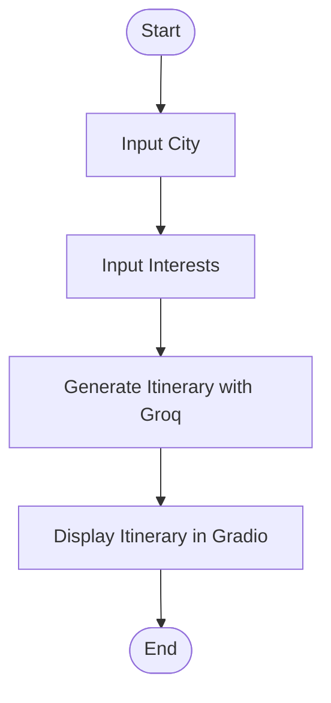

# ✈️ Travel Itinerary Planner

An AI-powered travel planning application that generates personalized day-trip itineraries based on a user's destination and interests. Built using **LangGraph, Groq, Llama 3.3, and Gradio**, the application demonstrates state-based workflow orchestration and LLM-powered itinerary generation.

## ✨ Features

- 🌍 **Destination-Based Planning:** Enter a city to generate a personalized day-trip itinerary.
- 🎯 **Interest-Based Recommendations:** Customize itineraries using comma-separated interests.
- 🤖 **AI-Powered Generation:** Uses Llama 3.3 70B Versatile through Groq.
- 🔗 **Workflow Orchestration:** Uses LangGraph to manage the itinerary-generation workflow.
- 💬 **Interactive UI:** A simple Gradio interface for entering preferences and viewing results.

## 🛠️ Tech Stack

- **Python** — Core application logic
- **LangGraph** — Workflow and state management
- **LangChain** — Prompt templates and LLM integration
- **Groq API** — Access to the Llama 3.3 70B Versatile model
- **Gradio** — Interactive web interface

## ⚙️ How It Works

The application follows a sequential workflow:

1. **Input City:** Captures the user's travel destination.
2. **Input Interests:** Processes interests such as food, history, nature, or adventure.
3. **Generate Itinerary:** Sends the destination and interests to the LLM to create a brief, bulleted day-trip plan.
4. **Display Results:** Shows the generated itinerary in the Gradio interface.

### Workflow Architecture



## 🚀 Getting Started

### 1. Clone the Repository

```bash
git clone <your-repository-url>
cd <your-repository-folder>
```

### 2. Install Dependencies

```bash
pip install -U langgraph langchain-groq gradio langchain-core
```

### 3. Configure Your Groq API Key

Get an API key from the [Groq Console](https://console.groq.com/).

Set it as an environment variable:

**Linux/macOS**
```bash
export GROQ_API_KEY="your_api_key"
```

**Windows PowerShell**
```powershell
$env:GROQ_API_KEY="your_api_key"
```

Update your Python code to load the key securely:

```python
import os
from langchain_groq import ChatGroq

llm = ChatGroq(
    temperature=0,
    groq_api_key=os.environ["GROQ_API_KEY"],
    model_name="llama-3.3-70b-versatile"
)
```

### 4. Run the Application

Run your notebook in Google Colab or Jupyter Notebook, or save the application code as a Python script and execute:

```bash
python app.py
```

The Gradio interface will launch and provide access to the travel planner.

## 💡 Example Usage

**Destination:** Paris

**Interests:** History, food, art, architecture

**Expected Output:** A brief, personalized day-trip itinerary with suggested activities based on the destination and interests.

*Note: The actual recommendations are generated dynamically by the language model.*

## 📁 Project Structure

```text
travel-itinerary-planner/
├── app.py              # Application and Gradio interface
├── README.md           # Project documentation
└── requirements.txt    # Python dependencies
```

## 🔐 Security

- Store API keys in environment variables.
- Never commit API keys or other credentials to version control.
- Add `.env` to `.gitignore` if you use a local environment file.

## 🔮 Future Improvements

- Integrate maps and location-based recommendations.
- Add hotel and restaurant suggestions.
- Include estimated travel times and budgets.
- Support multi-day itineraries.
- Add conversation memory for follow-up requests.
- Introduce conditional routing and specialized travel agents.

## 🎯 Learning Outcomes

This project demonstrates practical applications of LLM integration, prompt engineering, typed state management, graph-based workflow orchestration, and rapid UI development.

## 🤝 Contributing

Contributions, suggestions, and improvements are welcome. Feel free to fork the repository and submit a pull request.

## 📄 License

Add a license file if you intend to distribute this project publicly.

---

**Built with Python, LangGraph, Groq, and Gradio.** ❤️
